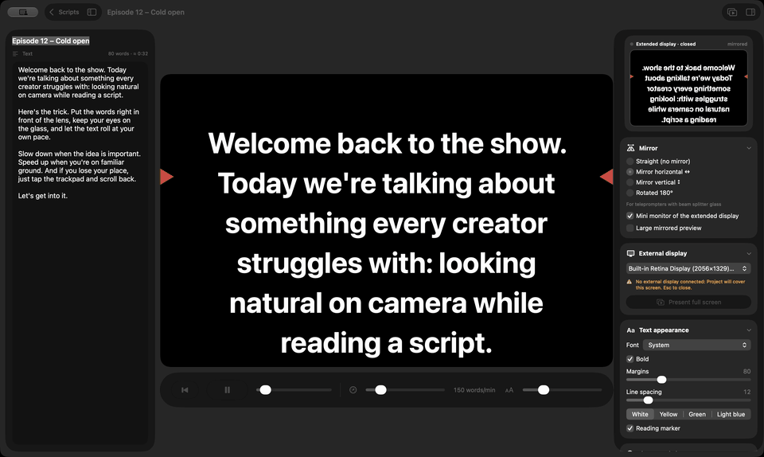
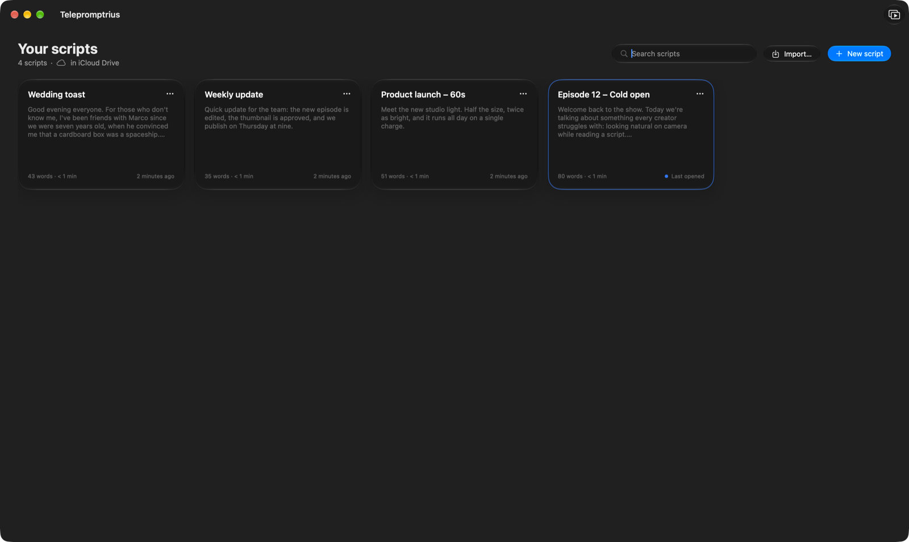

# Telepromptrius

**English** · [Italiano](README.it.md)

<p align="center">
  <a href="https://github.com/enricovezzu/telepromptrius/releases/latest/download/Telepromptrius.dmg">
    
  </a>
  <br><sub>Free and open source · macOS 26 or later · Apple silicon and Intel</sub>
  <br><br>
  <a href="https://paypal.me/enricovezzu">
    
  </a>
</p>

**A free teleprompter for the Mac.** You read the script straight on your own screen. On the external display under the teleprompter glass, it scrolls mirrored, so it reads correctly in the reflection.

<p align="center"></p>

## Features

- **Mirroring for beam-splitter glass:** horizontal, vertical or rotated 180°, applied only to the external display.
- **Mini monitor:** shows exactly what the external display is showing, so you never have to turn around and check.
- **Smooth 120 Hz scrolling:** works with ProMotion, and you can scroll with the trackpad or a presentation clicker (Page Up and Page Down).
- **Script library:** search your scripts and import from Word, RTF, Markdown or plain text.
- **Synced with iCloud Drive:** each script is a plain `.txt` file in *iCloud Drive → Telepromptrius*, so you can edit it from your iPhone or iPad too.
- **Words per minute and read-time estimate:** shown for every script.
- **Text appearance:** choose the font, size, margins, line spacing and color, and turn the reading marker on or off.
- **Dark and light themes:** with a Liquid Glass design.
- **20 languages:** English, Italian, Spanish, French, German, Portuguese, Chinese (Simplified and Traditional), Japanese, Korean, Russian, Ukrainian, Arabic, Hindi, Turkish, Dutch, Polish, Vietnamese, Indonesian and Thai.
- **Automatic updates:** every update package is signed and checked before it is installed.

<p align="center"></p>

## Install

1. Download **[Telepromptrius.dmg](https://github.com/enricovezzu/telepromptrius/releases/latest/download/Telepromptrius.dmg)**, open it and drag the app into **Applications**.
2. **The first time only:** the app is not notarized by Apple, because it is a free project without a paid developer account. So macOS will say it can't verify the app.
   1. Click **Done**.
   2. Open **System Settings → Privacy & Security**.
   3. Scroll down and click **Open Anyway** next to Telepromptrius.
3. From then on, the app updates itself.

## Keyboard shortcuts

| Key | Action |
|---|---|
| Space or Page Down | Play / pause |
| Page Up | Jump back |
| ↑ ↓ | Change the speed |
| ← → | Change the text size |
| R | Back to the start |
| M | Change the mirror mode |
| Esc | Close the full-screen teleprompter |
| ⌘L / ⌘E / ⌘I | Library / editor / side panels |

## Privacy

Telepromptrius collects nothing. It never contacts any server except one anonymous request to GitHub's public API, to check whether there is a newer version. Your scripts stay on your Mac and in your iCloud Drive.

## Build from source

You only need the Xcode Command Line Tools (`xcode-select --install`).

```bash
./build.sh            # builds for this Mac's chip and installs it in /Applications
./dist.sh             # builds the universal DMG and the signed update package in dist/
python3 tools/check-lang.py   # checks that every language in lang/ has every string
```

The whole app is a single SwiftUI and AppKit file, `main.swift`. Translations are in `lang/<code>.lproj/Localizable.strings`, and the keys are the Italian strings.

## Support

Telepromptrius is free and will stay free. If it saves you a subscription, you can buy me a coffee on PayPal. It also helps to star the repo or share it with someone who films.

## License

[MIT](LICENSE) © 2026 Enrico Vezzù
